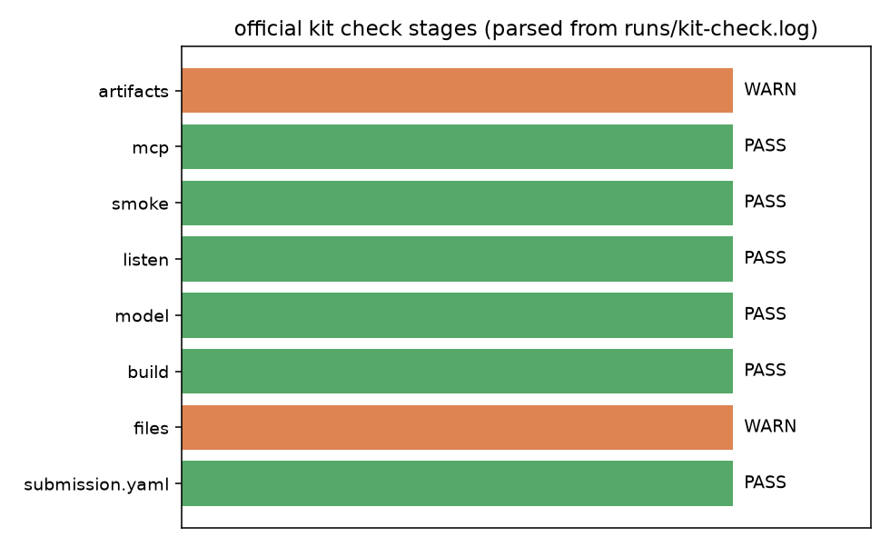
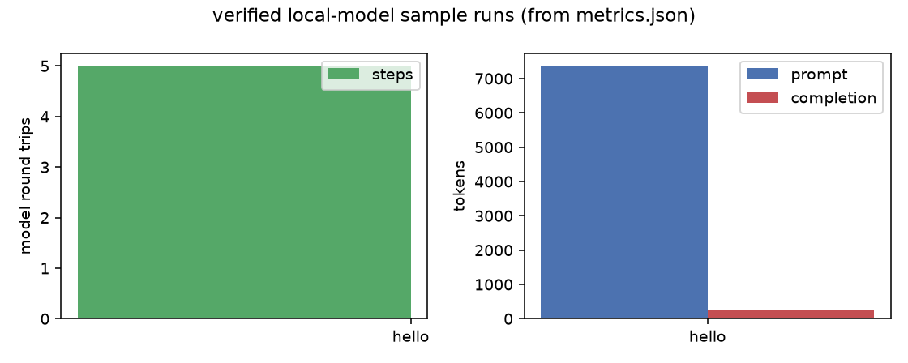
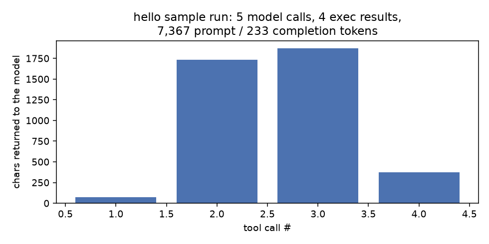

# A minimal harness that gives the model one shell and the task's MCP tools

**Entry:** `bnty-0709-harness-v1` · repo: https://github.com/DSP-AID/dail-bnty-0709 (the current `main` HEAD is the verified commit)
**Model endpoint used for verification:** a locally hosted Qwen3-class
multimodal model (OpenAI-compatible server, native tool calling). The
competition itself pairs harnesses with the eight sponsored `google-cloud/*`
models; our harness reads `MODEL_NAME`, `OPENAI_BASE_URL` and the key exactly
as `docs/models.md` specifies, so swapping is a config change, not a code
change.



## 1. What the harness is

The whole entry is three files plus one vendored bridge:

* **`submission.yaml`** — the kit entry (name, model API, install, serve). It
  validates against the official spec offline; we vendored `spec.py` and
  `models.py` from the kit precisely so that this validation runs in CI with
  no network.
* **`serve.py`** — a WebSocket server on `$PORT` that speaks the official
  serve protocol via `taskbridge.py` (copied verbatim from
  `sample_submissions/custom-openai`, as the organizers instruct). Per task it
  starts one agent loop, and for each MCP server the task declares it
  enumerates that server's tools and exposes them to the model as
  `<server>__<tool>` functions.
* **`agent_core.py`** — the agent loop, deliberately free of any transport or
  protocol so it can be unit-tested with a mock model and a mock exec.

The tool surface is intentionally tiny: **one shell plus the task's own MCP
tools.** `exec(command)` runs `bash -c` in the task workspace; stdout+stderr
and the exit code go back to the model; output longer than 24k chars is cut
around the middle so the head *and* the tail survive — engineering tasks often
end their interesting output at the tail. We rejected browser tools, file
editors, python REPLs and sub-agents for v1: every extra tool is another
schema the model can misuse, and PLE tasks are graded on files the agent must
produce with tools that already exist in a 2-CPU/4-GB container.

The loop stops on a plain-text reply, on the deadline the bridge reports, or
at `MAX_STEPS` — at which point the model gets one forced wrap-up turn so
there is always a final message describing what it completed and what is
missing. Model calls retry on 429/5xx and transport errors (5/15/30 s), fail
fast on other 4xx, and a failing tool call is fed back to the model as text
rather than crashing the run: we would rather spend two steps recovering than
zero score on a transient hiccup.

## 2. What we verified, and how

Everything below is reproducible on a clean machine with **no API keys**: unit
tests use a mock model and a mock exec; the end-to-end stages need only an
OpenAI-compatible endpoint you own.

* **10 offline unit tests** (`python3 -m pytest tests/ -q`) covering: the loop
  step accounting, exec-failure feedback, the step-budget wrap-up, the time
  guard, output head/tail cutting, MCP tool dispatch, and the HTTP chat layer
  against a mock server (retry on 500, fail-fast on 4xx, malformed-JSON
  tolerance).
* **The official `kit check` public sample stages**, run against our harness
  container with our local model through the kit's egress proxy — all stages
  that ran passed: entry spec, image build, model reachability, websocket
  listen, the HELLO smoke task (`hello.txt` written in 49 s), and the MCP
  stage (`mcp.txt` written via the task's `secret_word` tool in 26 s). The
  committed log is `runs/kit-check.log`.
* **The same sample instructions replayed without Docker** via
  `runner_local.py`, kept as auditable evidence: `runs/hello/` holds the full
  step-by-step trajectory, its metrics and the produced `hello.txt`; the
  long-memo replay (`runs/long-memo/metrics.json` plus its `run.log`) spent
  2,015,301 prompt / 58,270 completion tokens over 50 model round trips, wrote
  the memo as `part1.md` / `part2.md` / `part3.md`, and then ended on a
  content-only message announcing more work — the "pause is not a finish" bug
  below, at full length. Every figure is read straight from those committed
  files by `scripts/make_figures.py`.




One honesty note we want on the record: `kit check` for a self-hosted model
ends with *"model_api names a model of your own, which runs locally only"* —
it will never print "ready to submit" until paired with a `google-cloud/*`
model. Every PASS above is genuine; the absence of that one line is a property
of running our own endpoint, not a failure of the harness.

## 3. What actually broke (failure analysis)

* **Working-directory ambiguity.** The HELLO instruction says "a file named
  hello.txt in the working directory". Run through `runner_local.py` (no
  Docker), the model tried `/app/hello.txt` first — the path `kit check` uses
  — then probed, created, and finally wrote `hello.txt` in the actual exec
  cwd: 5 steps where 1 should do. Inside the kit's container it takes one. The
  fix now in the system prompt is one sentence: *"your exec tool runs with
  cwd = the task workspace; write relative paths there."*
* **MCP was not optional.** v1 launched as exec-only; the kit's own public
  sample set includes an MCP stage. We extended the loop mid-flight with a
  dispatch rule — any function name that is not `exec` routes to the MCP
  client — which cost one extra parameter, one branch, and one test. The
  stage then passed on the first re-run.
* **A pause is not a finish.** The loop ends on any model message that carries
  no tool call — that is the "final message" contract. Both long-memo replays
  tripped on it: the 50-round-trip run stopped right after writing three memo
  parts and announcing its next edit, and the replay after the cwd fix stopped
  after 7 round trips (11,422 prompt / 7,238 completion tokens) with *"let me
  rewrite with explicit dimensional checks"* and the memo unwritten. Both are
  committed (`runs/long-memo/`, and `runs/long-memo-retry/` with its trajectory
  and final message) so the failure is visible rather than hidden; the next
  iteration forces one more round trip when a content-only message does not
  name a written file.
* **Gated inputs.** The full dev task inputs live in an auto-gated Hugging
  Face dataset; without a token the files 401. So "runs end-to-end on public
  sample tasks" here means the kit's own smoke stages plus their verbatim
  instructions, bundled in `samples/`. We did not invent any dev-set score:
  `eval/run.py` on the 29 public dev tasks is the next milestone and needs a
  HF token + harbor.

## 4. What we deliberately did not build (yet)

No context compaction, no caching, no parallel sub-agents, no retries-with
re-plan, no self-verification pass. Each of these is a plausible Stage-2 win —
the trajectories in `runs/` are there so the wins can be measured rather than
assumed — but for v1 the priority was a loop that cannot die and cannot lie:
bounded steps, bounded time, always a final message, every number in this
writeup parsed from a committed log (`scripts/make_figures.py` plots straight
from `runs/*/metrics.json`, it cannot print a number we did not run).

## 5. Reproduce it

```bash
python3 -m pytest tests/ -q                     # offline, no keys
python -m kit check . --model-base-url <url> --env-file env.txt   # official stages
MODEL_NAME=<m> OPENAI_BASE_URL=<u> python runner_local.py samples/hello /tmp/out
```

Apache-2.0, vendored files unmodified and attributed. The full January entry
runs the three harbor runs on the hidden set; this repo is the harness that
will run them.
